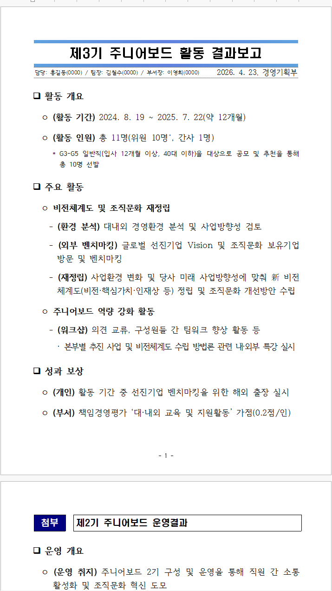
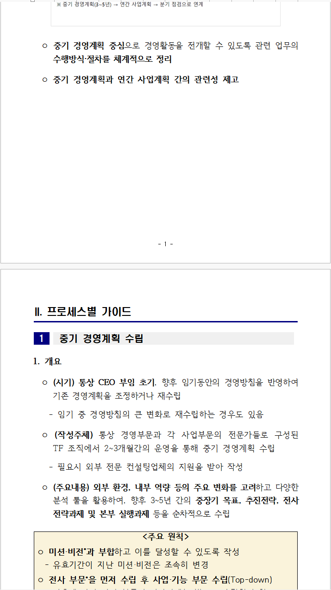

# 코스콤 한글 보고서 스킬 (koscom-hwp-report)

메모·회의록·초안처럼 **내용만 주면** AI 에이전트가 코스콤 보고용 표준 양식의 한글(`.hwp`) 파일을 만들어 주는 에이전트 스킬입니다. Claude Code, Codex CLI, Gemini CLI, Cursor 등 셸 명령을 실행할 수 있는 에이전트면 모델과 상관없이 씁니다. 서식·렌더링·문체 검사는 스크립트가 합니다.

공용 양식은 세 가지이고, 각 양식의 공식 샘플로 잰 **기본 문체**가 함께 들어 있습니다.

- **보고서 양식(요약보고):** 제목 박스(결재라인·날짜·부서), □ 대제목, ㅇ / - / · 단계, 표, 첨부·참고
- **투자계획서 양식(상세보고):** 표지, 목차(쪽번호 자동), I. 장 / [1] 절 박스, 그림, 별첨
- **기안문 양식:** 관련 근거(가./나.), 요청 문장, `- 아 래 -`, 1. 2. 번호 항목, ㅇ / - / · 단계, 예산 표. 수신자·제목·첨부·결재 칸은 전자결재 시스템 자동생성 영역이라 양식 그대로 둡니다

원본 양식은 `templates/source/`, 기본 문체는 `templates/voice/<양식>/`에 있습니다. 대표 문서를 주지 않으면 이 기본 문체로 문체를 검사합니다. 보고서·투자계획서는 샘플이 1건이라 등급이 `문체 시험용`이고(AI 상투구와 숫자 대조만 반드시 지키며 문체 지표는 참고), 기안문은 사람이 쓴 기안문 3건으로 만든 `문체 소표본`이라 문체 지표까지 검사합니다.

글꼴·간격·표 서식은 원본 템플릿에서 뽑은 블록을 그대로 복제해 채웁니다. 그래서 손으로 서식을 맞출 필요가 없습니다.

| 요약보고 예시 | 상세보고 예시 |
|---|---|
|  |  |

*예시는 `references/examples/`의 샘플을 렌더링해 한컴 뷰어로 캡처한 화면입니다. 결재라인은 가명입니다.*

---

## 이렇게 요청하면 됩니다

에이전트에 평소 말하듯 쓰면 됩니다. "코스콤", "hwp"라고 하지 않아도 사내 보고 문서를 만드는 요청이면 스킬이 동작합니다.

```text
팀장님께 올릴 보고서 하나 한글 파일로 만들어줘. 우리 회사 요약보고 양식으로.
제목: 11월 전사 정보보호 교육 결과
작성: 정보보호부 / 담당 홍길동(1234), 팀장 김철수(2345), 부서장 이영희(3456) / 2026년 11월 28일
- 교육 기간은 11월 3일부터 21일까지 3주
- 대상 412명, 이수 397명(96.4%), 작년 91.2%보다 5.2%p 상승
- 미이수 15명은 12월 12일까지 추가 교육
결과 파일은 정보보호교육_결과보고.hwp 로 저장해줘.
```

```text
본부장 보고용으로 "생성형 AI 활용 업무혁신 추진계획"을 표지랑 목차 있는 상세보고서로 만들어줘.
디지털혁신본부 / AI전략팀, 담당 한지수(7201) / 팀장 오세훈(7200) / 부장 윤가람(7000), 2026.11
I. 추진 배경 … II. 추진 현황 … III. 추진 과제 … IV. 기대 효과 …
단계별 일정은 표로 정리해줘: 과제 / 1분기 / 2분기 / 3분기 / 4분기
```

```text
본사 회의실 화상회의 장비 교체 기안문 써줘. 관련 근거는 총무2026-0211(2026. 3. 4. : 회의실 운영 현황 점검 결과 보고).
추진 개요(배경·목적), 추진 내용, 추진 일정, 소요 예산 3.12억원(부가세 별도), 예산 현황 표까지.
```

에이전트는 다음 순서로 일합니다.

1. 내용을 코스콤 개조식으로 다듬습니다. 한 항목 3줄 이내, 명사형 종결, `(라벨)` 형식입니다.
2. 다듬은 내용을 `report.json`으로 정리합니다.
3. 렌더러로 `.hwp`를 만들고 경고를 확인합니다.
4. 한컴 뷰어로 열어 화면을 캡처하고 줄 걸침·쪽 넘침·목차 쪽번호를 확인합니다.
5. 파일 경로, 보고서 구성, 남은 확인 사항을 알려 줍니다.

**팁**
- **결재라인:** 정보를 주지 않으면 지어내지 않고 `○○○(내선)`으로 비워 둡니다.
- **보고 유형:** 요약보고인지 상세보고인지 말하지 않으면 분량을 보고 정합니다.
- **고쳐 다시 만들기:** 결과 폴더에 남는 `report.json`을 고쳐 "이 JSON으로 다시 만들어줘"라고 하면 됩니다.
- **표:** 칸 병합도 됩니다(예: "수도권 두 줄은 권역 칸 하나로 합쳐줘"). 참고 점선 박스 안에 표를 넣어도 박스 폭에 맞춰 줄어듭니다.

### 문체 맞추기 (gn-voice 방식)

내가 직접 쓴 예전 보고서 2~3건을 주면, 그 문체를 숫자로 분석해 같은 문체로 새 보고서를 씁니다.

```text
예전에 쓴 결과보고서 두 개(D:\보고서\9월_점검결과.hwp, D:\보고서\10월_점검결과.hwp) 문체 분석해서,
그 문체로 11월 점검 결과보고서 써줘. 점검 42건, 조치 완료 39건, 미조치 3건은 12월 5일까지 조치 예정.
```

1. **분석:** 대표 문서의 끝맺음 비율(명사형·~함·~임), 자주 쓴 끝말과 표현, 항목 길이, `(라벨)` 사용, 머리 기호, 날짜·금액·증감 표기를 재고 원문 예문을 골라 `style-guide.md`로 정리합니다. 분석만 원하면 여기서 끝납니다.
2. **작성:** 코스콤 서식 규칙(3줄 이내, 단계 기호, 제목 칸 형식)은 그대로 지키고, 끝맺음·표현·표기는 가이드를 따릅니다.
3. **검사:** 스크립트가 report.json을 문체 밴드와 대조하고(벗어난 지표 3개 이상이면 불합격, AI 상투구·이모지는 즉시 불합격), 근거에 없는 숫자가 생기면 불합격시킵니다. 불합격 항목만 고쳐 최대 2번 다시 씁니다.

- 대표 문서는 **사람이 직접 쓴 것**만 씁니다. 1건은 `문체 시험용`, 2~3건은 `문체 소표본`, 한 건 빼고 검증이 실패하면 `문체 미검증`으로 표시합니다.
- 읽는 형식: `.hwp` · `.hwpx` · `.txt` · `.md` (워드·PDF는 본문을 `.txt`로 저장).
- 분석 결과(`style-guide.md`, `corpus\`)에는 대표 문서 문장이 그대로 들어 있습니다. 공유 전에 개인정보를 확인하세요.

---

## 설치

### 1. 준비물

| 항목 | 필요 여부 | 확인 방법 |
|---|---|---|
| Windows 10/11 | 필수 | |
| AI 에이전트: 셸 명령 실행과 파일 읽기·쓰기가 되는 것 (Claude Code, Codex CLI, Gemini CLI, Cursor 등) | 필수 | |
| Java 8 이상 (JRE로 충분) | 필수 | PowerShell에서 `java -version` (PATH에 없으면 `JAVA_HOME`을 읽습니다) |
| Python 3.9 이상 | 문체 기능을 쓸 때만 | `python --version` (표준 라이브러리만 씁니다) |
| 한컴오피스 뷰어 또는 한글 | 권장 | 없으면 결과 화면 확인만 건너뜁니다 |
| Git 또는 GitHub CLI | 설치할 때만 | `git --version` / `gh --version` |

> 이 스킬은 내 PC에서 PowerShell·Java·한컴 뷰어를 실행합니다. 그래서 웹 채팅(claude.ai, ChatGPT 웹 등)에 올려서는 동작하지 않습니다. **Windows에서 도는 에이전트**에서 사용하세요.

### 2. 저장소 접근 권한

비공개 저장소입니다. 저장소 관리자(humanist96)에게 GitHub 계정을 알려 주고 **Collaborator 초대**를 받은 뒤 진행하세요.

### 3. 스킬 폴더에 내려받기

에이전트마다 스킬을 읽는 폴더가 다릅니다. 폴더 이름은 반드시 `koscom-hwp-report`로 하세요(`SKILL.md`의 `name`과 같아야 합니다).

| 에이전트 | 받을 위치 또는 방법 |
|---|---|
| Claude Code | `%USERPROFILE%\.claude\skills\koscom-hwp-report` |
| Codex CLI | `%USERPROFILE%\.codex\skills\koscom-hwp-report` |
| Gemini CLI | 아무 곳에나 받은 뒤 `gemini skills link <받은 폴더>` |
| 그 밖의 에이전트 (Cursor, Copilot 등) | 아무 곳에나 받고 그 폴더를 엽니다. `AGENTS.md`가 `SKILL.md`로 안내합니다. 다른 폴더에서 쓸 때는 "`<받은 폴더>\SKILL.md`를 읽고 따라 해"라고 시킵니다 |

아래 예시는 Claude Code 위치입니다. 다른 에이전트는 경로만 바꾸세요.

GitHub CLI를 쓰는 경우:

```powershell
gh repo clone humanist96/koscom_hangul_skill "$env:USERPROFILE\.claude\skills\koscom-hwp-report"
```

Git을 쓰는 경우:

```powershell
git clone https://github.com/humanist96/koscom_hangul_skill.git "$env:USERPROFILE\.claude\skills\koscom-hwp-report"
```

팀 프로젝트 저장소에서만 쓰려면 그 프로젝트의 `.claude\skills\koscom-hwp-report\`에 넣어도 됩니다.

### 4. 확인

에이전트를 새로 열고 다음처럼 물어보세요.

```text
코스콤 한글 보고서 스킬 있어?
```

스킬이 보이면 설치된 것입니다. 렌더러만 따로 시험하려면 다음을 실행합니다. 마지막 줄이 `OK …`이면 정상입니다.

```powershell
cd "$env:USERPROFILE\.claude\skills\koscom-hwp-report"
.\scripts\render.ps1 -Json references\examples\summary_sample.json -Out "$env:TEMP\test_summary.hwp"
```

### 5. 업데이트

```powershell
git -C "$env:USERPROFILE\.claude\skills\koscom-hwp-report" pull
```

---

## 자주 묻는 문제

| 증상 | 원인과 해결 |
|---|---|
| `java`를 찾을 수 없음 | Java를 설치하고 PowerShell을 새로 여세요(`java -version`으로 확인). 설치 없이 압축판 JRE를 쓰면 `JAVA_HOME`을 그 폴더로 지정합니다 |
| 렌더러가 `templates\summary_base.hwp`를 못 찾음 | 사내 개인정보 보호 도구가 템플릿을 `*.hwp.pia`로 암호화했을 수 있습니다. 암호를 해제하거나, 보안 담당 안내에 따라 저장소에서 다시 받으세요 |
| 만든 `.hwp`가 `.pia`로 바뀜 | 실명·내선번호가 들어간 문서는 보호 도구가 암호화할 수 있습니다. 사내 절차대로 해제해 사용하세요 |
| 결과 확인 단계에서 뷰어 창이 안 보이거나 시간 초과 | 에이전트 샌드박스 안에서는 뷰어 창이 보이지 않습니다. 에이전트가 샌드박스 밖 실행 권한을 물으면 허용하세요. 느린 PC는 뷰어를 한 번 직접 열어 둔 뒤 다시 시도하세요 |
| `WARN …` 줄이 나옴 | 서식 점검 결과입니다(3줄 초과, 한두 글자 걸침, 쪽 넘침, 칸 넘침 등). 보통 에이전트가 문장을 다듬어 다시 렌더링합니다. 경고 목록은 `SKILL.md` 5단계에 있습니다 |
| 줄바꿈·쪽이 한글 정식판과 조금 다름 | 줄·쪽 계산은 한컴 뷰어 화면으로 맞췄습니다. 쪽 경계에 아슬아슬한 내용은 열어서 확인하세요 |

**지원하지 않는 것:**
- 글자 색, 형광펜, 밑줄 같은 임의 서식
- 차트 자동 생성. 이미지로 만들어 그림으로 넣는 것은 됩니다
- 기존 `.hwp` 고쳐 쓰기
- 쪽번호 이외의 머리말·꼬리말

---

## 폴더 구성

```text
koscom-hwp-report/
├── SKILL.md                 # 에이전트가 읽는 작업 지침(트리거·작업 순서·경고 대응). 공개 Agent Skills 형식
├── AGENTS.md                # 스킬 폴더를 읽지 않는 에이전트용 진입 안내 → SKILL.md
├── references/
│   ├── writing_guide.md     # 코스콤 개조식 작성 원칙
│   ├── report_schema.md     # report.json 형식(표·상세보고·그림 포함)
│   ├── style_map.md         # 블록별 글꼴·간격·구현 규칙
│   └── examples/            # 요약·상세·기안문 예시 JSON(가명)과 그림, voice/ 문체 시험용 합성 보고서 3건
├── scripts/
│   ├── render.ps1           # report.json → .hwp
│   ├── preview.ps1          # 한컴 뷰어로 열림 확인 + 뷰어 창만 캡처
│   ├── build.ps1            # src/ → koscom-hwp.jar 재빌드(JDK 필요)
│   ├── koscom-hwp.jar       # 렌더러
│   └── voice/               # 문체 분석·검사(voice_tool.py)와 자체검사(selftest.py)
├── templates/               # 보고서·투자계획서·기안문 원형 모음(*_base.hwp)과 블록 카탈로그
│   ├── source/              # 원본 공용 양식(보고서·투자계획서·기안문_템플릿.hwp) — 원형을 여기서 만듦
│   └── voice/               # 양식별 기본 문체(공식 샘플로 잰 style-guide.md·검사 밴드)
├── src/                     # 렌더러 소스(Java 8 호환)
├── lib/                     # hwplib 1.1.9 (Apache-2.0)
├── evals/                   # 평가 과제 4개(claude plugin eval 형식). summary-in-sample-voice 는 문체 기능 과제
└── docs/                    # README 그림
```

---

## 품질 평가

같은 요청 3개를 스킬을 쓴 경우와 쓰지 않은 경우로 나눠 비교했습니다. 2026년 10월, Claude Code로 잰 2차 반복 결과입니다.

| 과제 | 스킬 사용 | 스킬 미사용 |
|---|---|---|
| 회의 메모 → 요약보고 | 10/10 | 8/10 |
| 실적표(칸 병합) + 참고 → 요약보고 | 12/12 | 10/12 |
| 표지·목차 상세보고 | 11/11 | 8/11 |
| **평균 통과율 / 평균 소요 시간** | **100% / 약 4분** | **79% / 약 12분** |

스킬 없이도 Claude가 `.hwp`를 만들 수는 있습니다. 하지만 본문 글꼴, 템플릿 블록, 참고 라벨 박스, 목차 쪽번호 같은 **코스콤 서식 준수**에서 차이가 났습니다.

---

## 유지보수

- **렌더러 수정:** `src/`를 고친 뒤 `.\scripts\build.ps1`을 실행합니다. JDK(javac)가 필요합니다.
- **템플릿 재생성:** `TemplateBuilder`로 `templates/source/`의 원본 양식에서 다시 만듭니다. 명령은 `scripts\build.ps1` 머리 주석에 있습니다. 원형을 떼는 위치가 원본 양식의 문단 번호로 고정돼 있어, 원본 양식의 문단 배치를 바꾸면 `TemplateBuilder`도 같이 고쳐야 합니다. 자체검사 11번이 재생성 결과가 `templates/`와 같은지 확인합니다.
- **기본 문체 갱신:** 양식별 샘플이 늘면 `voice_tool.py build <샘플들> --out <임시폴더> --type <양식> --human`으로 다시 만들고, `corpus\`를 뺀 파일만 `templates/voice/<양식>/`에 복사합니다. `corpus\`에는 샘플 문장이 그대로 들어 있어 저장소에 넣지 않습니다.
- **줄·쪽 계산:** `src/Layout.java`(글자 폭·줄 경계)와 쪽 높이 모델은 한컴 뷰어 캡처로 잰 값입니다. 바꾸려면 다시 측정하세요.
- **평가 과제:** `evals/`에 있습니다. 새 기능을 넣으면 과제를 추가해 확인하는 것을 권장합니다.
- **문체 도구:** `scripts/voice/voice_tool.py`를 고쳤으면 `python scripts/voice/selftest.py`로 자체검사 11개(밴드·불합격 판정·숫자 대조·분석 가이드·report.json 읽기·렌더링 후 다시 읽기와 문단 끝 문자·원본 양식 재생성과 기본 문체)를 돌립니다. Java가 필요합니다.

문의와 개선 제안은 저장소 Issues 또는 관리자에게 보내 주세요.

## 라이선스와 주의

- `lib/hwplib-1.1.9.jar`는 [hwplib](https://github.com/neolord0/hwplib)(Apache License 2.0)입니다. 자세한 내용은 `lib/NOTICE.md`를 보세요.
- 템플릿과 서식은 코스콤 사내 보고 양식입니다. **사내 업무 용도로만** 쓰고 외부로 배포하지 마세요.
- 예시와 평가 과제의 이름·내선번호는 모두 가명입니다. `references/examples/voice/`의 보고서 3건도 합성(가상) 자료입니다.
- 문체 기능은 [gongnyang/gn-voice](https://github.com/gongnyang/gn-voice)의 방식(서식을 걷어낸 본문 → 문체 지표 → 범위 밴드 → 스크립트 검사)을 소표본용으로 줄인 코쇠오피스 `voice_tool.py`를 가져와 고친 것입니다. gn-voice의 코드·스킬 정의는 MIT이지만 저자의 글과 거기서 만든 데이터는 권리가 유보되어 있어, **방식만 참고하고 그 코퍼스·지문·상투구 목록은 가져오지 않았습니다.**
